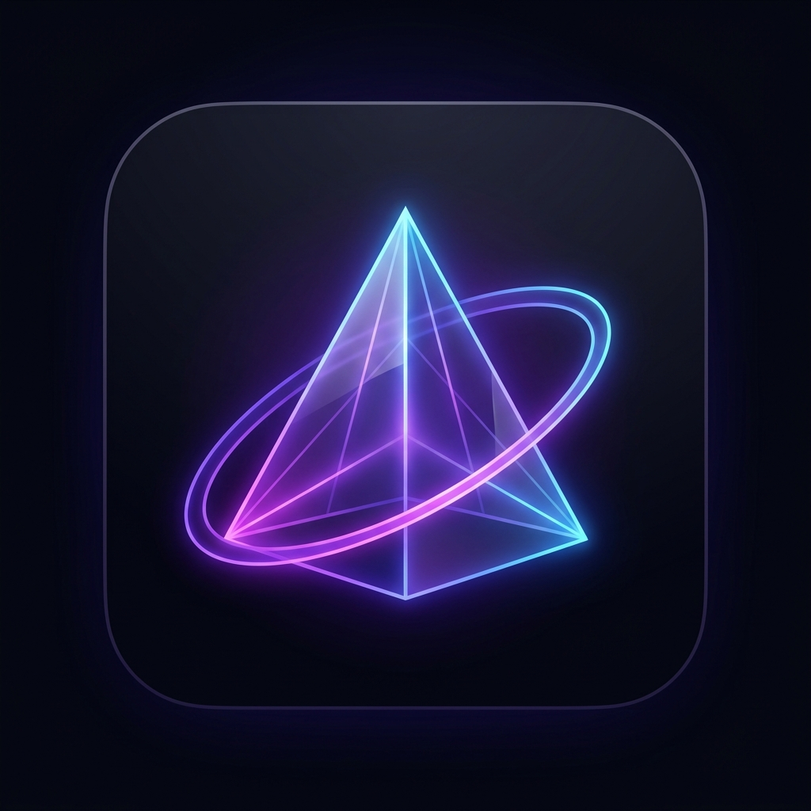

<div align="center">
  
  <h1>ZENITH — Focus & Time OS</h1>
  <p><strong>Ultra-modern dark-mode desktop productivity, task management, focus timer, and agenda OS built with Electron.</strong></p>
</div>

---

## ✨ Key Features

- **📋 Daily Tasks & Kanban Board (`To-Do` / `In Progress` / `Done`):**
  - Switch seamlessly between Grid Cards and 3-column drag-and-drop Kanban Board.
  - Set **Priority Levels** (`🔴 High`, `🟡 Medium`, `🟢 Low`) and **Category Tags** (`#Study`, `#Coding`, `#Exam`, `#Work`, `#Fitness`, `#Personal`).
  - Add **Subtasks / Checklists** with live progress bars and customize **Recurring Days** (`Sun–Sat`).
  - Choose between **Time Goals** (Hours & Minutes -> auto-starts Countdown Timer) or **Text Goals** (e.g., *2 Video Lectures*, *50 Questions* -> auto-starts Stopwatch from `00:00:00`).
- **⏱️ Triple Focus Engine (Stopwatch, Countdown Timer & Pomodoro):**
  - **Stopwatch**, **Countdown Timer**, and **Pomodoro (`25m / 45m / 60m`)** modes with dedicated **Break (Mola)** duration logging.
  - **🔒 Strict Focus Lock Mode:** Prevents accidental navigation or timer resets while a focus session is active.
  - **⭐ Post-Session Reflection:** Rate focus quality (`1–5 Stars`) and log session notes when timers finish.
- **🎧 Procedural Ambient Sound Mixer:**
  - Built-in Web Audio API soundscapes (**Soft Rain**, **Deep Brown Noise**, **Alpha Focus 40Hz Binaural**, **Cozy Fireplace**) with zero external audio dependencies.
- **📊 Authentic Analytics & 52-Week Contribution Heatmap:**
  - Weekly, Monthly, and Yearly focus breakdowns, **Category Focus Distribution**, **Session Reflections Log**, and a **GitHub-style 365-Day Consistency Heatmap**.
  - **📄 Shareable PNG Progress Card:** Export high-resolution daily performance report cards with a single click.
- **🏆 Gamification (XP, Levels & Ranks) & Daily Streak:**
  - Earn XP for completing tasks, subtasks, focus minutes, and hydration to level up from `Novice` to `Zenith Apex`.
  - Automatic midnight (`00:00`) daily streak & task reset engine.
- **📝 Quick Scratchpad & Pinned Sticky Notes:**
  - Instant auto-saving scratchpad with word counter alongside a pinned sticky notes board.
- **📅 Interactive Calendar & Scheduled Agenda:**
  - Plan future dates with custom times and receive native desktop notifications when scheduled plans arrive.
- **🪟 Always-On-Top Mini Desktop Widget & Global Hotkeys:**
  - Compact floating bar that stays on top of other apps (`Ctrl+Shift+M`), plus global shortcuts for Start/Pause (`Ctrl+Shift+S`) and Break (`Ctrl+Shift+B`).

---

## 🚀 Getting Started

### Prerequisites
- [Node.js](https://nodejs.org/) (v18 or newer recommended)

### Installation & Run
```bash
# 1. Clone the repository
git clone https://github.com/YOUR_USERNAME/ZENITH.git

# 2. Navigate into the project directory
cd ZENITH

# 3. Install dependencies
npm install

# 4. Launch ZENITH
npm start
```

---

## ⌨️ Global Keyboard Shortcuts

| Shortcut | Action |
| :--- | :--- |
| `Ctrl + Shift + S` | Start / Pause Active Timer |
| `Ctrl + Shift + B` | Start / End Break (Mola) |
| `Ctrl + Shift + M` | Toggle Always-On-Top Mini Widget |

---

## 📄 License

Distributed under the **MIT License**. See [`LICENSE`](LICENSE) for more information.
